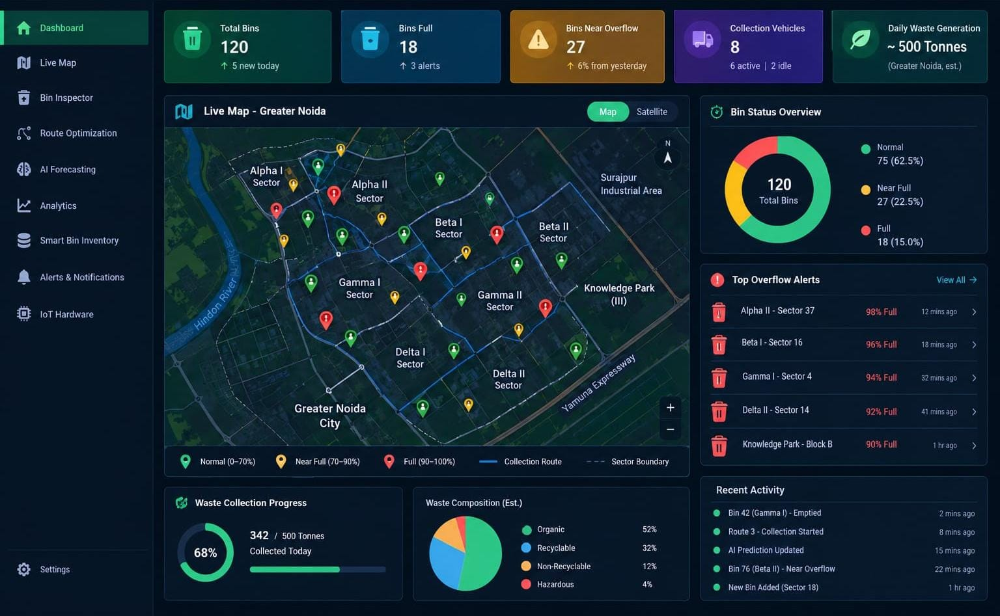
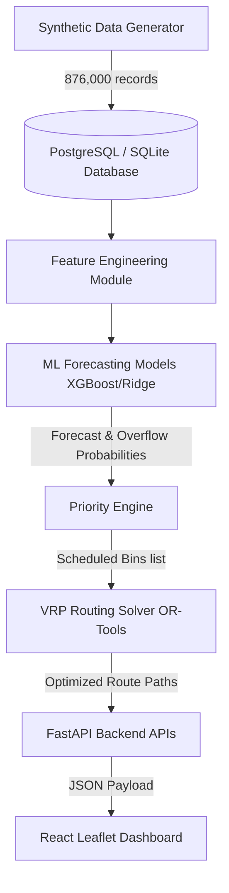
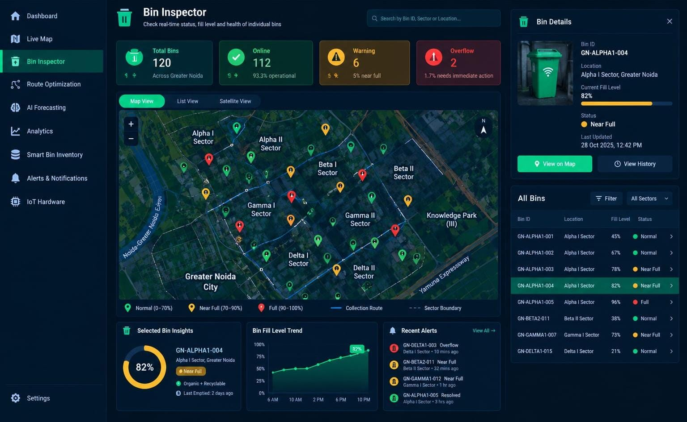
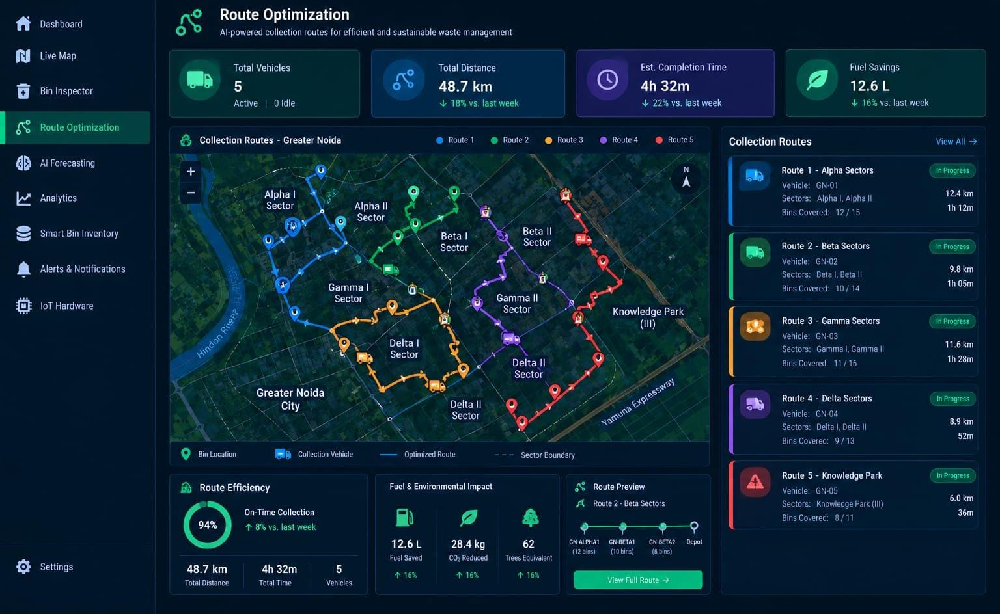
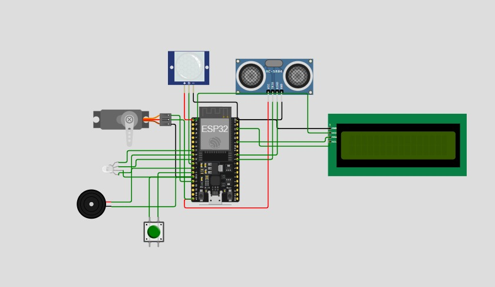

<div align="center">
  <h1>♻️ BinFlow</h1>
  <p><strong>Smart Waste Fill-Level Prediction & Route Optimization System</strong></p>

  [](https://www.python.org/downloads/)
  [](https://fastapi.tiangolo.com)
  [](https://reactjs.org/)
  [](https://www.postgresql.org/)
  [](https://www.docker.com/)
  [](https://opensource.org/licenses/MIT)
</div>

<br />

BinFlow is a municipal waste management system that simulates IoT bin sensors, predicts upcoming waste levels, identifies overflow risks, and solves vehicle routing using Google OR-Tools. It provides an interactive dark-themed dashboard to visualize bin locations, fill levels, and optimized collection routes.

<br />

<div align="center">
  
  <p><i>Dashboard with live map, bin status overview, overflow alerts, and collection progress.</i></p>
</div>

---

## 🚧 Project Status

BinFlow is under active development. The table below shows what is implemented so far.

| Module | Status |
|---|---|
| Dashboard (KPIs, live map, bin status, overflow alerts, recent activity) | ✅ Implemented |
| Live Map (bin markers, collection routes, sector boundaries) | ✅ Implemented |
| Bin Inspector (bin details, fill-level trend, alerts, bin list) | ✅ Implemented |
| Route Optimization (multi-vehicle routes, efficiency, fuel impact) | ✅ Implemented |
| IoT hardware circuit (ESP32 sensor design in Wokwi) | ✅ Implemented (simulation) |
| AI Forecasting page | 🔄 In progress |
| Analytics page | 🔄 In progress |
| Smart Bin Inventory page | 🔄 In progress |
| Alerts & Notifications page | 🔄 In progress |
| IoT Hardware page | 🔄 In progress |

---

## ✨ Key Features

- 📊 **Real-time Dashboard**: A dark-themed React + Leaflet dashboard for monitoring bin status, overflow alerts, and collection progress.
- 🗺️ **Live Map**: Color-coded bin markers by fill level, collection routes, and sector boundaries, with map and satellite views.
- 🔍 **Bin Inspector**: Per-bin details, fill-level trend, recent alerts, and a filterable bin list.
- 🚚 **Route Optimization**: Capacitated Vehicle Routing Problem (CVRP) solved with Google OR-Tools to reduce travel distance and fuel use.
- 🏭 **Synthetic Data Generation**: Built-in simulator that generates a year of hourly sensor readings (876,000 records).
- 🧠 **Forecasting Pipeline**: XGBoost and Ridge Regression models predict bin fill levels and overflow probability (backend pipeline; dashboard page in progress).
- 🐳 **Dockerized Deployment**: Containerized for easy setup and teardown.

---

## 🏗️ Architecture Overview



---

## 📸 Implemented Modules

### 1. 📊 Dashboard & Live Map
*Summary KPIs (total bins, full bins, bins near overflow, vehicles, daily waste), a live map of Greater Noida sectors, a bin status breakdown, top overflow alerts, collection progress, estimated waste composition, and recent activity.*

<div align="center">
  
</div>

### 2. 🔍 Bin Inspector
*Real-time status of individual bins: online, warning, and overflow counts, map/list/satellite views, a selected-bin detail panel with fill level and status, a fill-level trend chart, recent alerts, and a searchable list of all bins.*

<div align="center">
  
</div>

### 3. 🚚 Route Optimization
*Optimized collection routes for multiple vehicles shown on the map, with total distance, estimated completion time, and fuel savings. A route list shows each vehicle's sectors, bins covered, distance, and duration, along with route efficiency, fuel and environmental impact, and a route preview.*

<div align="center">
  
</div>

### 4. 🎛️ IoT Hardware Simulation
*Wokwi circuit design for the smart bin node: an ESP32 microcontroller connected to an HC-SR04 ultrasonic sensor for fill level, a PIR motion sensor, an LCD display, a servo motor, an LED, a buzzer, and a push button.*

<div align="center">
  
</div>

---

## 🛠️ Technology Stack

### Backend & Machine Learning
- **Python 3.9+**
- **FastAPI**: High-performance REST API framework.
- **SQLAlchemy**: ORM for database interactions.
- **XGBoost & scikit-learn**: For predictive modeling and forecasting.
- **Google OR-Tools**: For route optimization (VRP).

### Frontend
- **React 18** (with TypeScript)
- **Vite**: Frontend tooling.
- **Leaflet & React-Leaflet**: For interactive map visualizations.

### Hardware (simulation)
- **ESP32**, **HC-SR04**, **PIR sensor**, **LCD**, **servo**, **LED**, **buzzer**, simulated in **Wokwi**.

### Infrastructure
- **PostgreSQL / SQLite**
- **Docker & Docker Compose**

---

## 📂 Project Structure

```text
BinFlow-Smart-Waste-Management-System/
│
├── backend/                  # FastAPI web server
├── database/                 # Database schema and connections
├── ml/                       # Machine Learning Pipeline (Data Gen, Feature Eng, Models)
├── optimization/             # Operations Research (OR-Tools VRP Solver)
├── frontend/                 # React + TypeScript + Leaflet app
├── hardware/                 # Hardware simulation & configurations
├── docs/                     # Documentation and screenshots
│   └── screenshots/
├── run_pipeline.py           # Orchestrates end-to-end local run
├── requirements.txt          # Python dependencies
└── docker-compose.yml        # Docker orchestrator
```

---

## 🚀 Getting Started (Local Development)

### 1. Backend Setup

1. **Clone the repository:**
   ```bash
   git clone https://github.com/<your-username>/BinFlow-Smart-Waste-Management-System.git
   cd BinFlow-Smart-Waste-Management-System
   ```

2. **Create and activate a virtual environment:**
   ```bash
   python -m venv .venv

   # Windows:
   .venv\Scripts\activate

   # macOS/Linux:
   source .venv/bin/activate
   ```

3. **Install dependencies:**
   ```bash
   pip install -r requirements.txt
   ```

4. **Run the initialization and data pipeline:**
   This command creates the database schema, generates 365 days of hourly records (~876,000 records), trains the ML models, runs forecasting for tomorrow, and computes optimized routes.
   ```bash
   python run_pipeline.py
   ```

5. **Start the FastAPI server:**
   ```bash
   python -m uvicorn backend.main:app --reload --host 127.0.0.1 --port 8000
   ```
   > 💡 The API is available at `http://127.0.0.1:8000`. Swagger docs are at `http://127.0.0.1:8000/docs`.

### 2. Frontend Setup

1. **Navigate to the frontend directory:**
   ```bash
   cd frontend
   ```

2. **Install Node modules:**
   ```bash
   npm install
   ```

3. **Start the Vite development server:**
   ```bash
   npm run dev
   ```
   > 💡 Open `http://localhost:5173`. The frontend proxies API requests to `http://127.0.0.1:8000`.

---

## 🐳 Containerized Deployment (Docker)

```bash
docker-compose up --build -d
```

- **Frontend Dashboard**: `http://localhost:5173`
- **FastAPI API**: `http://localhost:8000`
- **PostgreSQL**: Local port `5432`

---

## 🔬 Optimization Logic

1. **Machine Learning Model**: XGBoost predicts tomorrow's fill level. Overflow probability is computed by comparing the prediction with the model's standard error (RMSE) using the normal distribution's cumulative distribution function:

   $$P(\text{Fill} \ge 80\%) = 1 - \Phi\left(\frac{80 - \hat{y}}{\text{RMSE}}\right)$$

   Ridge Regression and Persistence are used as baselines.

2. **Priority Score**: A combined score is calculated:

   $$\text{Priority} = (\text{Predicted Fill} \times 0.6) + (\text{Overflow Prob} \times 0.2) + (\text{Area Priority} \times 0.2)$$

3. **Google OR-Tools**: Solves a Capacitated Vehicle Routing Problem (CVRP) to route trucks through bins that exceed the priority threshold, minimizing distance while keeping total volume under vehicle capacity (5,000 L). Pairwise geodesic distances are scaled by a 1.3 routing factor to approximate road-network travel distance.

---

## 🗺️ Roadmap

- [ ] AI Forecasting page (24-hour forecast curves, overflow risk)
- [ ] Analytics page (strategy comparison, historical trends)
- [ ] Smart Bin Inventory page
- [ ] Alerts & Notifications page
- [ ] IoT Hardware page and live sensor integration
- [ ] Experimental evaluation of collection strategies (fixed schedule, reactive threshold, predictive CVRP)

---


